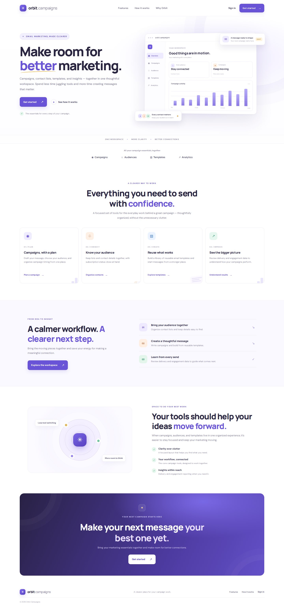
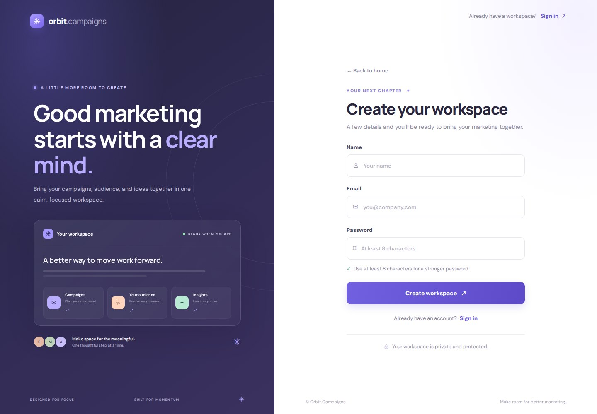
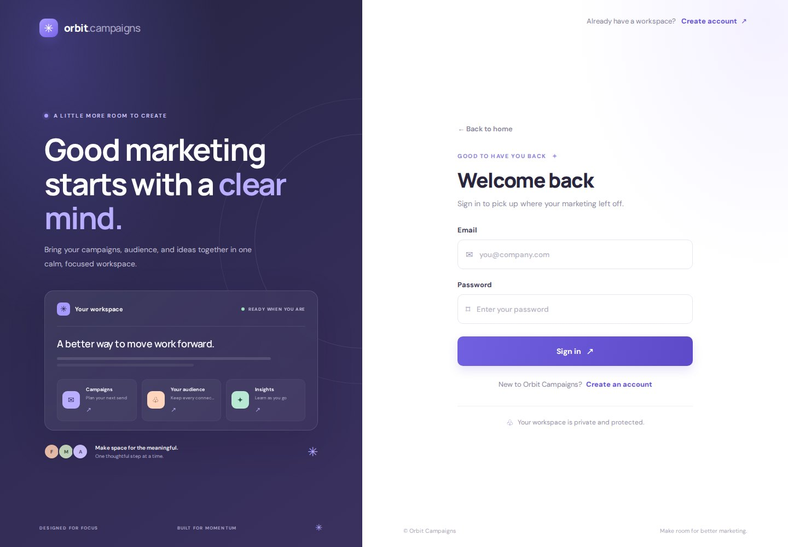
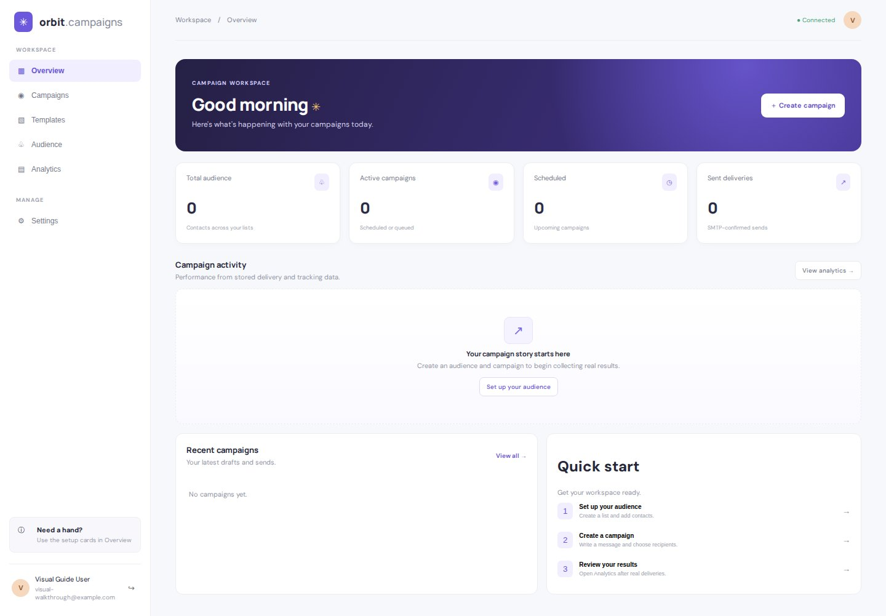
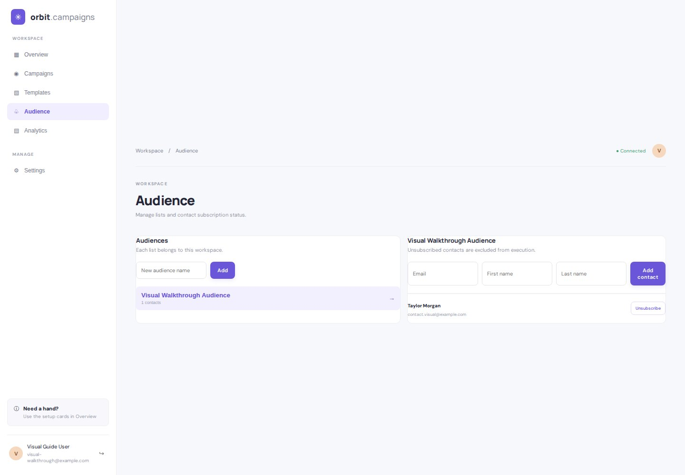
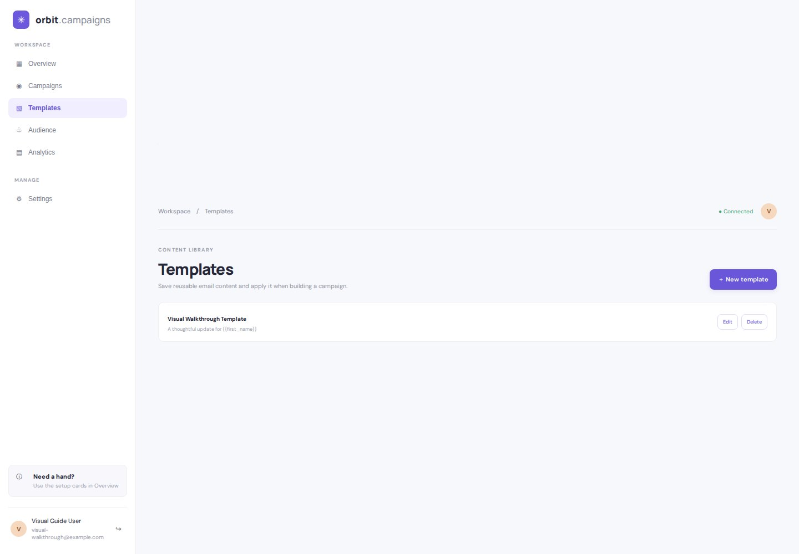
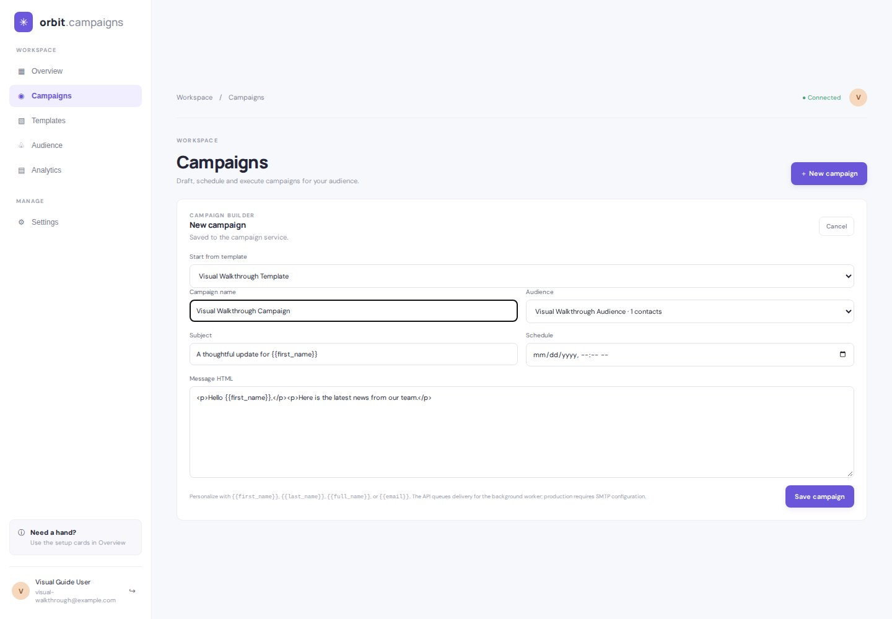
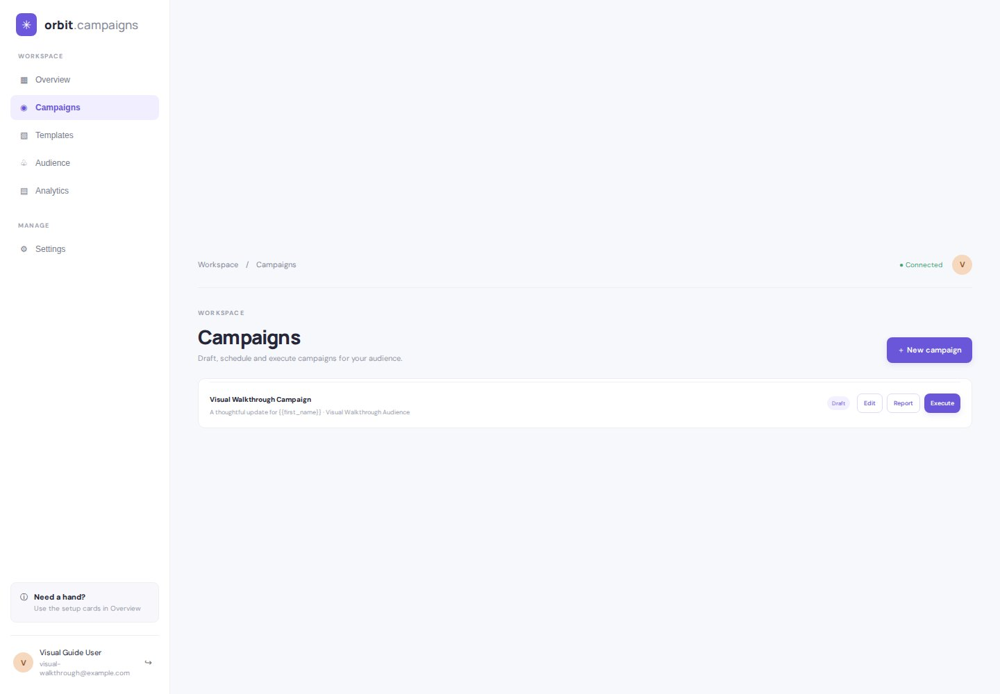
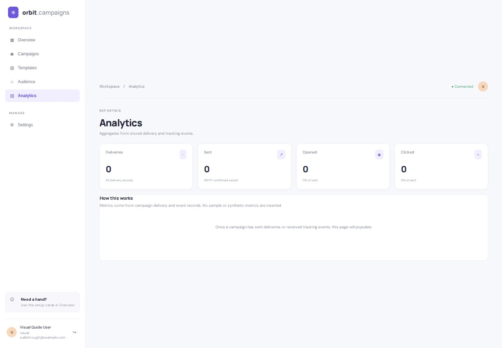

# Marketing Campaign Management — Visual Walkthrough

Orbit Campaigns brings campaign planning, audience lists, reusable email content, and delivery insights into one workspace. This walkthrough follows the main screens from first visit through creating a saved campaign.

The screenshots are browser captures produced by the integration walkthrough against the real frontend and FastAPI backend with PostgreSQL. The browser uses the visible interface to create the audience, contact, template, and campaign, then reads the saved records back from the backend. The screenshot flow does not replace API responses with mocks.

## 1. Landing page

The landing page introduces the campaign workspace and provides the account entry points.

## 2. Account access

### Create a workspace

New users can begin with a workspace account.

### Sign in

Returning users have a dedicated sign-in screen.

## 3. Workspace overview

The overview brings campaign activity, audience totals, scheduled work, and shortcuts together. Totals are loaded from the application rather than hard-coded sample metrics.

## 4. Audiences and contacts

Audiences organize contacts into lists. The walkthrough creates a list and adds a contact through the UI; the saved audience and contact are then read back from the backend.

## 5. Reusable templates

Templates keep email content reusable across campaigns. A saved template can supply the subject and message body when composing a campaign.

## 6. Campaign builder

The campaign editor combines the campaign name, audience, subject, schedule, and message content. The screenshot shows a saved template applied to the draft before saving the campaign.

## 7. Saved campaign

The campaign appears in the workspace as a draft after the save action. The walkthrough confirms that the draft is present in the backend before capturing the screen.

## 8. Analytics

Analytics is based on stored delivery and tracking events. The clean walkthrough account has no sent deliveries yet, so this screenshot does not imply email delivery or engagement results that have not occurred.

## Related repositories

- [Frontend repository](https://github.com/faizansaiyed123/marketing-campaign-management-frontend)
- [Backend repository](https://github.com/faizansaiyed123/marketing-campaign-management-backend)

Email sending depends on valid server-side SMTP configuration and the campaign worker. The screenshots document the visible product workflow; they do not claim that this CI walkthrough sent real email.
